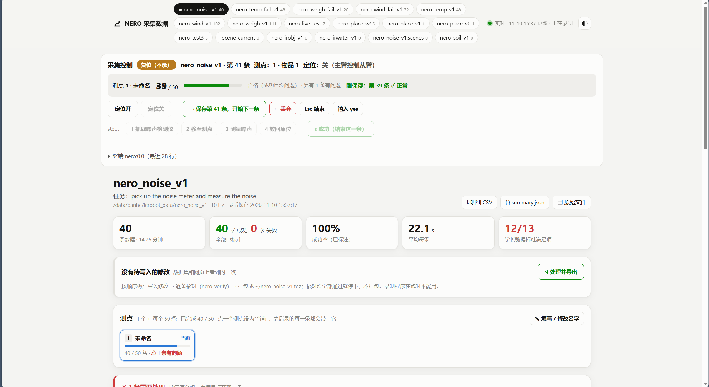
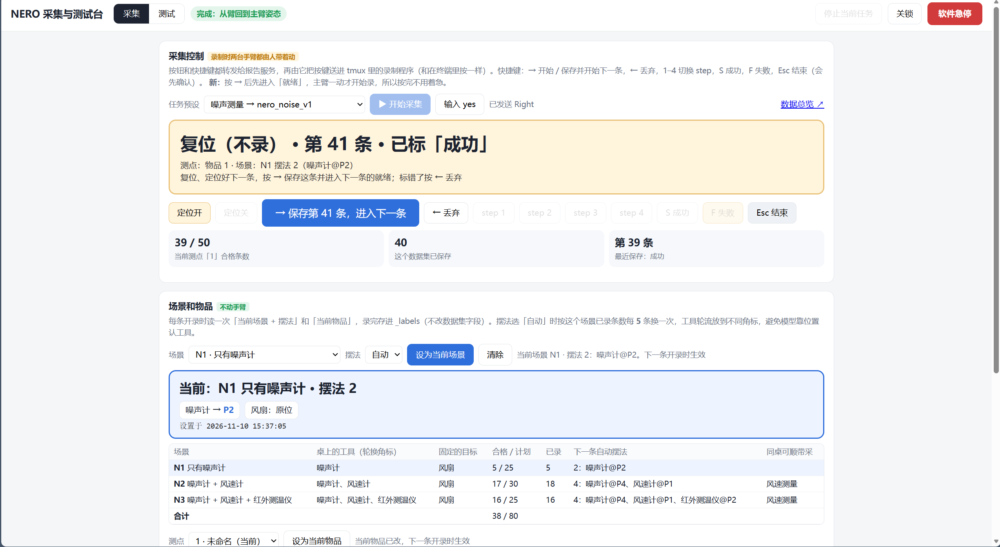
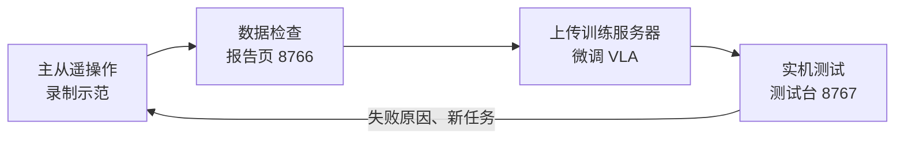
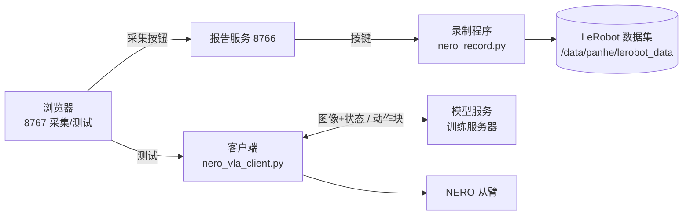
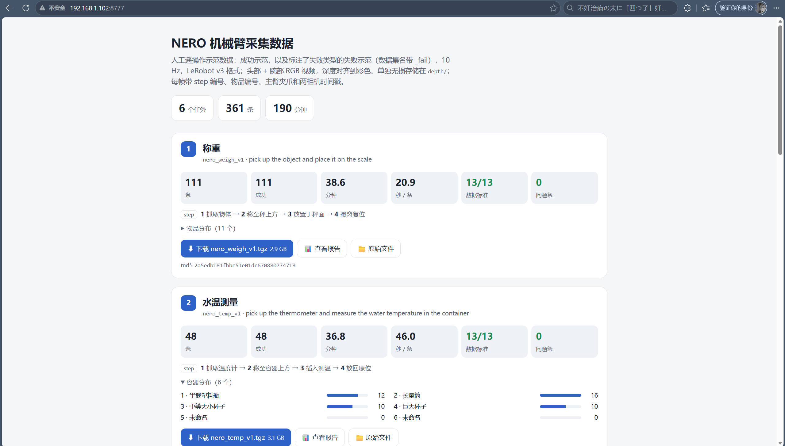

# NERO 机械臂：数据采集与 VLA 实机测评工具

在 NERO 7 轴机械臂（主从遥操作）上采集 LeRobot v3 数据集、在实机上测试 VLA 模型的一整套工具。我们用它采了称重、测水温、测风速等 7 个桌面任务的示范数据，微调 VLA 模型（XR-1），再回到实机上逐步测试、记录、分析失败原因。

本仓库只包含我们自己写的代码。机械臂驱动（agx_arm_ws、pyAgxArm）、Click-to-Reach 定位网页和 IK 来自课题组已有项目，模型训练代码在训练服务器上，都不在这里。

<p align="center">
  
  
</p>
<p align="center"><sub>左：采集模式（录制状态、按键、场景和摆法、物品进度）　右：模型测试台（逐步执行、实时状态、评测记录）</sub></p>

## 整体流程



一台网页同时管采集和测试（端口 8767，顶部切换）。采集模式本身不碰录制，按钮都转发给报告服务（8766），由它给 tmux 里的录制程序送按键；测试模式启动客户端，连训练服务器上的模型服务推理，再下发给从臂执行。



## 目录

| 目录 | 内容 |
|---|---|
| `plugins/` | LeRobot 插件：从臂 `lerobot_robot_nero`、主臂 `lerobot_teleoperator_nero`、ROS 相机 `lerobot_camera_ros` |
| `record/` | 录制：`nero_record.sh` / `nero_record.py`（步骤按键、物品标签、10 Hz 存储、深度、两相机时间戳、动了才开录、场景记录），以及开机检查（主从对齐、限位、急停、相机） |
| `data_tools/` | 数据处理：单条统计、数据标准检查、步骤修改、逐条核对、删条、汇总页；任务预设 `nero_tasks.json`、场景表 `nero_scenes.json` |
| `web/` | 报告服务（8766）：录制控制接口、进度、改步骤和物品、一键导出 |
| `vla/` | 模型测试：采集+测试网页 `nero_vla_web.py`（8767）、客户端、步骤文本 `nero_steps.py`、连接检查、回到主臂姿态、动作块回放、夹爪观测 |
| `nav/` | 定位网页的安全检查 `nav_guard.py`（路径离台面高度模拟）和轨迹记录 |
| `ops/` | 环境变量、一键体检 |

## 任务

每个任务分 4 步：抓取工具 → 移到作业位置 → 测量（停留）→ 放回原位。录制时在每一步结束时按对应数字键，步骤号逐帧存在 `step_index` 里。

| 预设 | 数据集 | 指令 |
|---|---|---|
| weigh | nero_weigh_v1 | pick up the object and place it on the scale |
| task2 | nero_temp_v1 | pick up the thermometer and measure the water temperature in the container |
| task3 | nero_wind_v1 | pick up the anemometer and measure the wind speed |
| noise | nero_noise_v1 | pick up the noise meter and measure the noise |
| soil | nero_soil_v1 | pick up the soil probe and insert it into the soil to measure |
| irwater | nero_irwater_v1 | pick up the infrared thermometer and measure the water temperature in the container |
| irobj | nero_irobj_v1 | pick up the infrared thermometer and measure the temperature of the object |

前三个任务另有失败预设（`weigh_fail` 等），用来采带失败类型标注的数据：F1–F4 表示失败发生在第几步，定义写在 `nero_tasks.json` 里。

新的四个任务按场景采集：每个任务 3 个场景，桌上的干扰工具从无到多（例如测噪声：只有噪声计 → 加风速计 → 再加红外测温仪）。工具放在桌面贴好的角标 P1–P4 上，每 5 条轮换一次位置，网页会提示这一条该怎么摆。场景表见 `data_tools/nero_scenes.json`。

## 采集

```bash
# 报告服务（tmux 一个窗口，evo-rl 环境）
bash ~/nero_report_serve.sh
# 网页（另一个窗口，系统 Python）
conda deactivate
/usr/bin/python3 ~/nero_vla_web.py
```

Windows 上转发两个端口后打开 http://127.0.0.1:8767 ：

```bash
ssh -L 8767:127.0.0.1:8767 -L 8766:127.0.0.1:8766 panhe@192.168.1.102
```

一条示范的流程：

1. 选任务预设和场景，按网页提示摆好工具；复位后用「定位」把双臂带到起始位置
2. 按 → 进入「就绪」：这时还不录，主臂任一关节动超过 0.5° 才开始录，所以数据开头没有静止段（`NERO_ARM_START=0` 可关掉，`NERO_ARM_DEG` 改阈值）
3. 遥操作完成任务，每步结束按 2 / 3 / 4，放回后按 S
4. 复位、摆好下一条后按 →，这一条保存；录坏了按 ← 丢弃

每条开录时会读网页设的当前场景，保存时写进 `_labels/<数据集>.scenes.json`，不改数据集本身的字段。



## 测试

在测试模式里填模型服务地址，先「检查连接」，再按 check（只推理）→ dry（推理并显示动作，不动手臂）→ live（实机执行）逐级来。几个主要选项：

- `--exec-steps`：每个 30 步的动作块执行前几步就重新推理（10 = 1 秒）
- `--step-prompt`：把 `Step k/4: <步骤名>` 接到指令后面，给带步骤文本训练的模型用；操作员在每步完成时按「本步完成」，客户端从 `--step-file` 读当前步骤。训练和测试用同一份 `nero_steps.py`，保证文本一字不差
- `--slow`：放慢执行，第一次测新模型时用

每次运行保存每次推理的头部/腕部图像、动作块、从臂实际轨迹（`feedback.npz`）和 summary；评测结果（每步是否完成、物品、场景、备注）按任务存成 jsonl，测试台上可以直接看成功率和逐块回放。

## 数据格式

- LeRobot v3，10 Hz（控制循环 30 Hz，每 3 帧存 1 帧）
- `observation.state` / `action`：8 维，joint1–7（rad）+ gripper（m，0–0.1）；`action` 的夹爪是主臂指令换算到从臂行程
- 头部 + 腕部 RGB 视频；对齐到彩色的深度另存为无损 mkv（`depth/<相机>/episode_XXXXXX.mkv`，uint16 毫米）
- 逐帧附加字段（不以 `observation.` 开头，不作为模型输入）：`step_index`（1–4）、`item_index`、`leader.gripper.pos`、`camera.stamp_ms`、`camera.sync_ms`、`camera.depth_rgb_ms`
- `_labels/<数据集>.json`：物品名、失败类型；`_labels/<数据集>.scenes.json`：每条的场景和摆法

## 依赖

Ubuntu + ROS 2 Humble、RealSense ROS 驱动、Evo-RL（LeRobot）conda 环境、NERO 驱动与 pyAgxArm。脚本里的路径和 IP 按实验室服务器写死，部署时所有脚本平铺在 `~/` 下；换机器时需要修改（见 `ops/env_evo.sh`）。

## 说明

- `nav/ik_click_deploy.sh` 部署定位网页时会用到基于原项目修改的 `app.py`、`ros_robot.py` 和 `ros_camera.py`，这几个文件不在本仓库。
- 安全约定：机械臂运动时必须有人手放实体急停；不要用关闭使能来急停。「就绪」阶段不能开定位，因为定位会带动主臂，马上触发开录。
